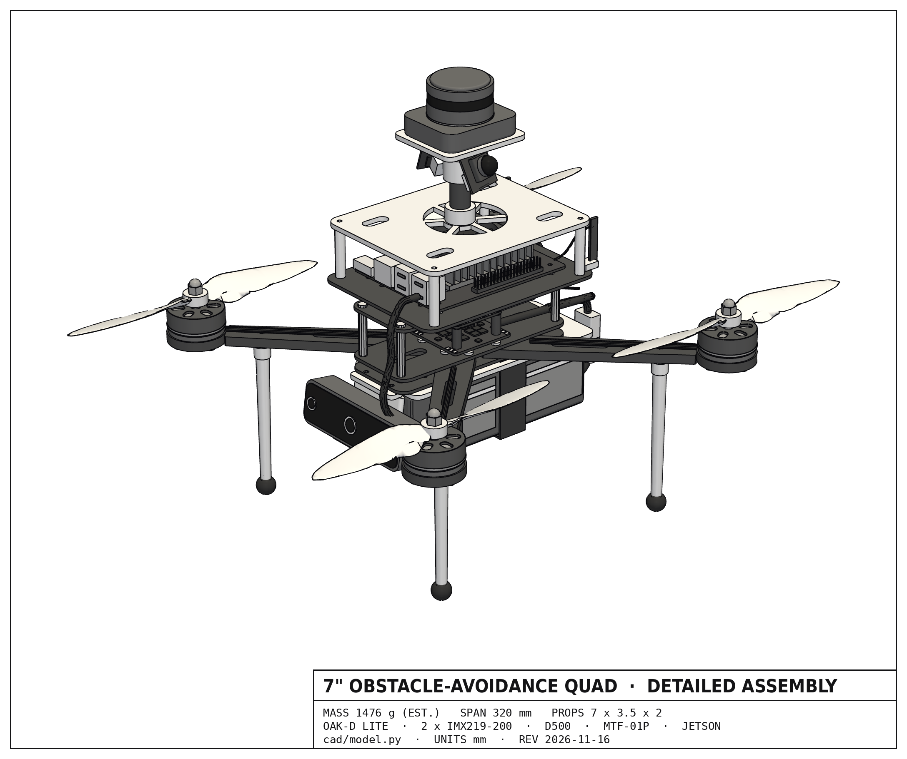

# CAD

The 7" drone, built for flying from A to B while avoiding still and moving obstacles. It has a TBS Source One V5 7" frame, the battery underneath, a Jetson Orin Nano Super on a damped deck, a printed bridge over the Jetson carrying the mast, two IMX219-200 side cameras and the Waveshare D500 lidar on the mast, the OAK-D Lite under the nose and the MTF-01P under the rear-right arm. The layout follows P1's hardware decision log and dodge analysis, and P2's decisions 0001 and 0002.



| File | What it is |
| --- | --- |
| `drone_3d.html` | Interactive 3D page of the detailed model. Open it in a browser (see below) |
| `drone_render.png`, `drone_lineart.png` | Black-and-white renders of the detailed model: grey shaded with edges, and line art |
| `model.step` | The detailed model for Fusion 360, SolidWorks, FreeCAD or Onshape |
| `skeleton.png` | Top, side and front views with the sensor views, the parts table, mass and the check findings |
| `skeleton.step` | The simple block layout, with the sensor views as solids |
| `skeleton.py` | Lays out every part, checks parts against each other and every sensor view, and works out mass and balance |
| `model.py` | Builds the detailed parts inside the skeleton's layout, checks them again, and writes `model.step` and `drone_3d.html` |
| `render.py` | Makes the two black-and-white renders with VTK |
| `page_template.html` | The 3D page, before `model.py` puts the model inside it |

Lengths are mm, X forward, Y left, Z up, with Z = 0 at the prop plane. The sim's `base_link` sits 36 mm below the prop plane, so add 36 mm to Z for transforms from `base_link`.

## View the 3D model

You need a browser and an internet connection, which loads the 3D library and fonts. You don't need ROS, Python or CAD software. The model is inside the HTML file, so it opens on its own.

GitHub only shows the file's code when you click it, so get a copy on your computer first. Use either way:

**Download just the file**

1. Open [`cad/drone_3d.html`](https://github.com/sumedhperamanu/Autonomous-Drone/blob/p3/interface-agreement/cad/drone_3d.html) on GitHub.
2. Click the **Download raw file** button at the top right of the file.
3. Double-click the downloaded file to open it in your browser.

**Or use a copy of the repo**

```bash
git fetch origin
git checkout p3/interface-agreement
git pull
```

Then open the file:

- Windows: `start cad\drone_3d.html`
- WSL Ubuntu: `explorer.exe "$(wslpath -w cad/drone_3d.html)"`
- Linux: `xdg-open cad/drone_3d.html`

Once this branch is merged, use `main` in place of `p3/interface-agreement`.

**Using the page**

| Do this | To do this |
| --- | --- |
| Left-drag, scroll, right-drag | Rotate, zoom, move the view |
| Click a part, a numbered pin or a name in the part index | Show only that part and read what it does, its numbers and its mass |
| Esc, or **Clear** | Show the whole drone again |
| **Explode** or the slider | Pull the assembly apart |
| **OAK-D view**, **Side cameras**, **Lidar plane**, **Flow + range** | Show or hide what each sensor covers |
| **3/4**, **Front**, **Side**, **Top**, **Below** | Jump to a view |
| **Turntable** | Spin the model slowly |

The camera views are drawn 0.5 m and 0.22 m long and the lidar plane 0.46 m wide so they don't cover the drone. The real sensors see 12 m or more.

## Rebuild the files

```bash
pip install cadquery matplotlib
python3 skeleton.py
python3 model.py
python3 render.py
```

`render.py` uses VTK, which comes with cadquery, and Pillow.

## Current result

| Check | Result |
| --- | --- |
| Total mass | 1,476 g with the battery at 567 g, about 1,382 g at 473 g (P1: about 1,383 g; requirement 1.2–1.8 kg) |
| Centre of mass | 2 mm behind centre, 18 mm below the prop plane |
| Inertia | 0.0073, 0.0088, 0.0096 kg m^2 (roll, pitch, yaw) |
| OAK-D Lite | P1's position: front face 84 mm ahead of centre, 50 mm below the props |
| Side cameras | On the mast, 100 mm above the props and 22 mm either side of it, 15° rearward, tilted up 25° |
| Lidar scan plane | 138 mm above the props |
| Flow sensor on the ground | 90 mm up (80 mm minimum) |
| Parts overlapping | None |

## What the checks found

| Finding | What it means |
| --- | --- |
| The OAK-D Lite sees about 3% of each front prop disc along the top edge of its view | Mask that strip in software. Keeping the props fully out would need the camera 98 mm below the props, too close to the ground |
| Each side camera sees about 27% of a rear prop disc low in its view, and the edge of the lidar at the top | Mask both in software, or tilt the cameras up about 34° instead of 25°, which clears the props but sees less below the horizon. Measure the real lens first |
| P1's MTF-01P height (22 mm below the props) is inside the rear-right arm | It's placed just under the arm here, lens 40.5 mm below the props |
| P1's 16 mm between each side camera and the mast leaves no room for the 25 mm board once it's tilted up | They sit 22 mm either side here |
| P1's battery height (centre 33 mm below the props) is inside the frame | It hangs under the bottom plate on a 3 mm tray here, centre 55 mm below the props |

## What the detailed model adds

- Carbon plates and arms with cut-outs, screw holes and motor pads
- 2807 motors with vented bells, and 7x3.5 two-blade props with real twist and taper, spinning the PX4 quad X way
- The flight stack on spacers and grommets, the BEC, and the receiver with its dipole on the rear-right arm
- The Jetson Orin Nano Super dev kit with its heatsink, fan, ports, NVMe SSD and Wi-Fi antennas, on a deck over rubber dampers, with its 12 V lead from the BEC
- A printed bridge over the Jetson with a fan guard, carrying the carbon mast, the side-camera collar and the D500
- Both IMX219-200 side cameras with their fisheye lenses, and the OAK-D Lite with its three lenses on a printed cradle tilted up 8°, with its USB cable to the Jetson
- The battery under the frame on a printed tray with two straps, its XT60 lead up to the ESC and its balance lead
- The MTF-01P in a printed holder, and printed legs with rubber feet bolted under the arms

The printed parts (orange in the 3D page) are drafts that fit this layout. Design the final ones from the frame's real CAD files.

## Check these first

The parts table in `skeleton.png` marks where each number came from: `P1/P2` for P1's and P2's records, `listing` for a seller's page or datasheet, `estimate` for my guess.

- Frame: motor height (18 mm from arm to prop), plate sizes (130 x 50 mm), arm size, and the 30 mm standoffs. Check them against the Source One V5 7" files in the [source_one repo](https://github.com/tbs-trappy/source_one).
- Motor positions. They assume a square X at 320 mm.
- Battery mass and size: listed at 473 g or 567 g; weigh it.
- Masses of the deck, dampers, bridge, mast, mounts, legs, BEC and the 60 g of wires and straps.
- The D500's scan window height above its base (24 mm here) and the side cameras' real field of view.
