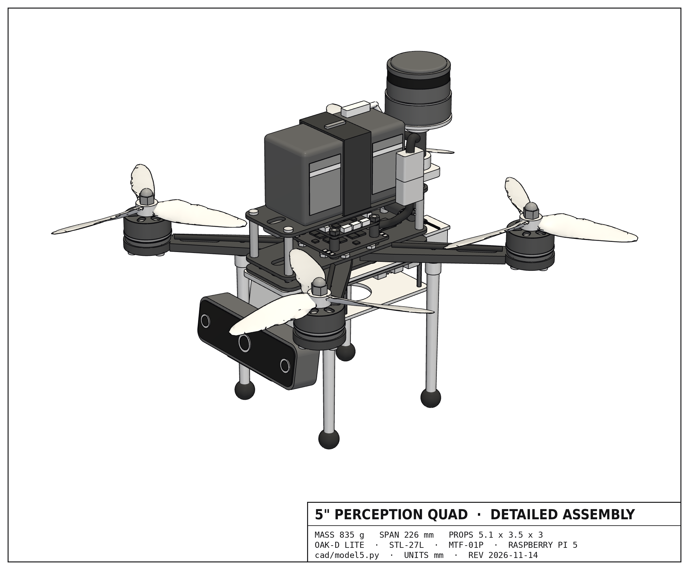

# CAD

The 5" drone, built for flying from A to B while avoiding still and moving obstacles. It has a Source One V5 5" frame, the OAK-D Lite under the nose, the STL-27L lidar on a rear mast, the MTF-01P under the rear of the frame, a Raspberry Pi 5 hung under the bottom plate and the battery on top.



| File | What it is |
| --- | --- |
| `drone5_3d.html` | Interactive 3D page of the detailed model. Open it in a browser (see below) |
| `drone5_render.png`, `drone5_lineart.png` | Black-and-white renders of the detailed model: grey shaded with edges, and line art |
| `model5.step` | The detailed model, 121 parts, for Fusion 360, SolidWorks, FreeCAD or Onshape |
| `skeleton.png` | Top, side and front views with the sensor views, the parts table, mass and the check findings |
| `skeleton.step` | The simple block layout, with the sensor views as solids |
| `skeleton.py` | Lays out every part, finds the OAK-D Lite mount, checks parts against each other and every sensor view, and works out mass and balance |
| `model5.py` | Builds the detailed parts inside the skeleton's layout, checks them again, and writes `model5.step` and `drone5_3d.html` |
| `page_template.html` | The 3D page, before `model5.py` puts the model inside it |
| `render5.py` | Makes the two black-and-white renders with VTK |

Lengths are mm, X forward, Y left, Z up, with Z = 0 at the prop plane. The sim's `base_link` sits 26.9 mm below the prop plane, so add 26.9 mm to Z for transforms from `base_link`.

## View the 3D model

You need a browser and an internet connection, which loads the 3D library and fonts. You don't need ROS, Python or CAD software. The model is inside the HTML file, so it opens on its own.

GitHub only shows the file's code when you click it, so get a copy on your computer first. Use either way:

**Download just the file**

1. Open [`cad/drone5_3d.html`](https://github.com/sumedhperamanu/Autonomous-Drone/blob/p3/interface-agreement/cad/drone5_3d.html) on GitHub.
2. Click the **Download raw file** button at the top right of the file. It's about 9 MB.
3. Double-click the downloaded file to open it in your browser.

**Or use a copy of the repo**

```bash
git fetch origin
git checkout p3/interface-agreement
git pull
```

Then open the file:

- Windows: `start cad\drone5_3d.html`
- WSL Ubuntu: `explorer.exe "$(wslpath -w cad/drone5_3d.html)"`
- Linux: `xdg-open cad/drone5_3d.html`

Once this branch is merged, use `main` in place of `p3/interface-agreement`.

**Using the page**

| Do this | To do this |
| --- | --- |
| Left-drag, scroll, right-drag | Rotate, zoom, move the view |
| Click a part, a numbered pin or a name in the part index | Show only that part and read what it does, its numbers and its mass |
| Esc, or **Clear** | Show the whole drone again |
| **Explode** or the slider | Pull the assembly apart |
| **OAK-D view**, **Lidar plane**, **Flow + range** | Show or hide what each sensor covers |
| **3/4**, **Front**, **Side**, **Top**, **Below** | Jump to a view |
| **Turntable** | Spin the model slowly |

The camera view is drawn 0.5 m long and the lidar plane 0.38 m wide so they don't cover the drone. The real sensors see 12 m and 25 m.

## Rebuild the files

```bash
pip install cadquery matplotlib
python3 skeleton.py
python3 model5.py
python3 render5.py
```

`model5.py` takes about 20 seconds and `render5.py` about 10. `render5.py` uses VTK, which comes with cadquery, and Pillow.

## Current result

| Check | Result |
| --- | --- |
| Total mass | 835 g, 919 g with a 10% margin (limit 950 g) |
| Centre of mass | 1 mm ahead of centre, 1.2 mm below the prop plane |
| Inertia | 0.0024, 0.0030, 0.0031 kg m^2 (roll, pitch, yaw) |
| OAK-D Lite mount | Front face 70 mm ahead of centre, 62 mm below the props: the lowest spot that keeps all four props out of view with a 3° margin |
| Lidar scan plane | 73 mm above the props, clear of the battery |
| Flow sensor on the ground | 84 mm up (80 mm minimum) |
| Skeleton checks | 35 parts, 4 views: no overlaps, nothing in any view |
| Detailed checks | 121 parts: no overlaps between assemblies, no mesh point in any sensor view, the 5.1" props included |

The mass counts the frame at its listed 123.5 g. P1's sim model `fiveinch` uses 0.819 kg, so update it when the drone is weighed.

## What the detailed model adds

- Carbon plates and arms with cut-outs, screw holes and motor pads
- XING2-style 2207 motors with vented bells, and HQ R35 5.1x3.5x3 props with real twist and taper, spinning the PX4 quad X way
- The flight stack: ESC and flight controller boards on spacers and grommets, the receiver and its antenna, the BEC and the 1000 µF capacitor
- The Raspberry Pi 5 upside down with its ports and Active Cooler, between a printed carrier and a guard tray
- The OAK-D Lite with its three lenses, on a printed cradle tilted up 8°
- The STL-27L on a carbon mast with printed mounts
- The MTF-01P in a printed holder
- The battery with its strap, XT60 lead and balance lead
- Printed legs with rubber feet, bolted under the arms

The printed parts (orange in the 3D page) are drafts that fit this layout. Design the final ones from the frame's real CAD files.

## Check these first

The parts table in `skeleton.png` marks where each number came from: `listing` for a seller's page, `estimate` for my guess.

- Frame: motor height (18 mm from arm to prop), plate sizes (110 x 42 mm), arm size and the 25 mm standoffs. Check them against the Source One V5 5" files in the [source_one repo](https://github.com/tbs-trappy/source_one).
- Motor positions. They assume a square X at 226 mm.
- Masses of the mounts, legs, BEC and the 22 g of wires and straps.
- Sensor sizes. The STL-27L is modelled at 39 mm across and 34 mm tall, and the MTF-01P at 29.3 x 17 x 14.5 mm; measure both.
- Leg positions: on the arm lines, 40 mm out in X and Y. They were moved there in this revision so they bolt to the arms; the views were rechecked.
